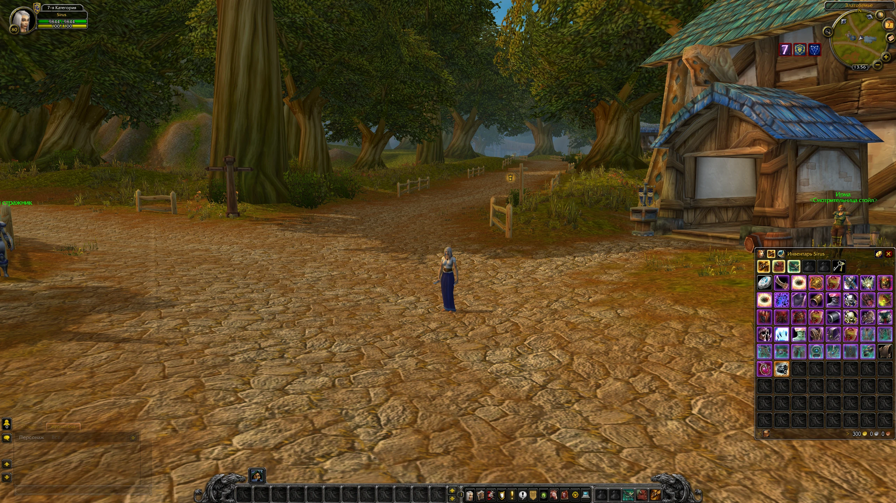
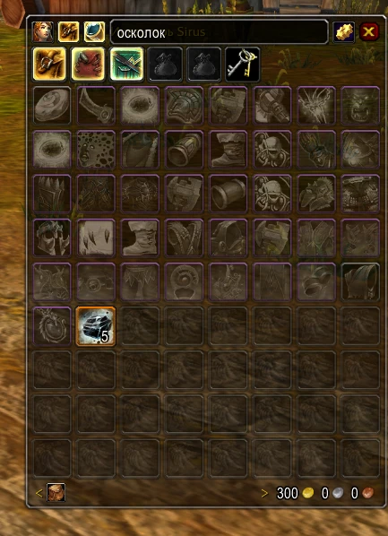
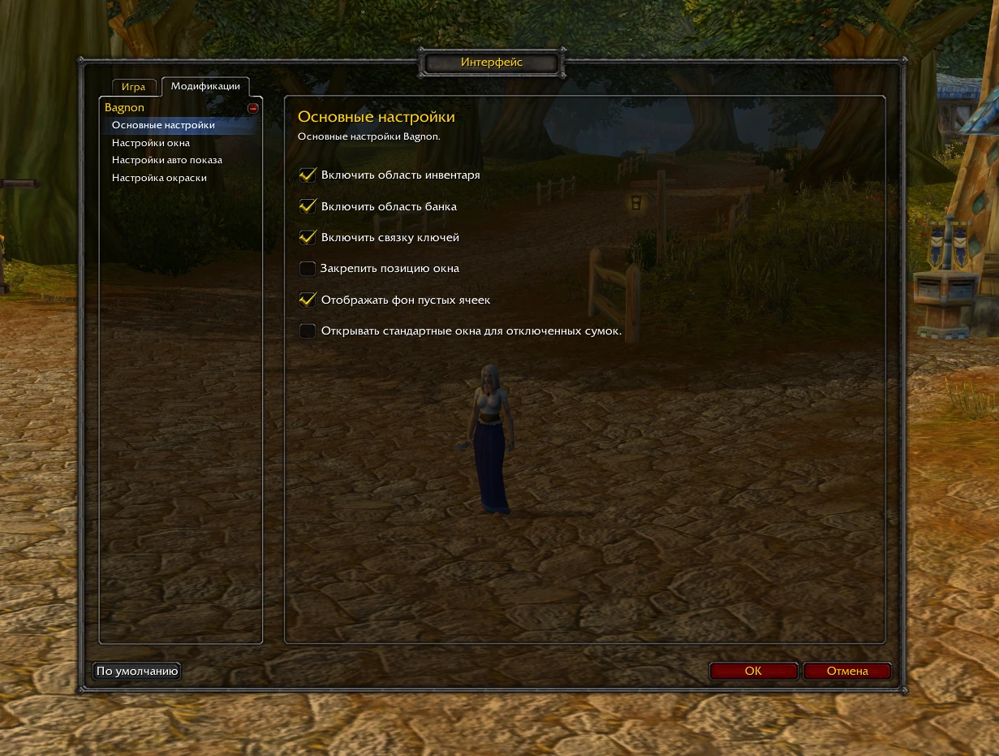
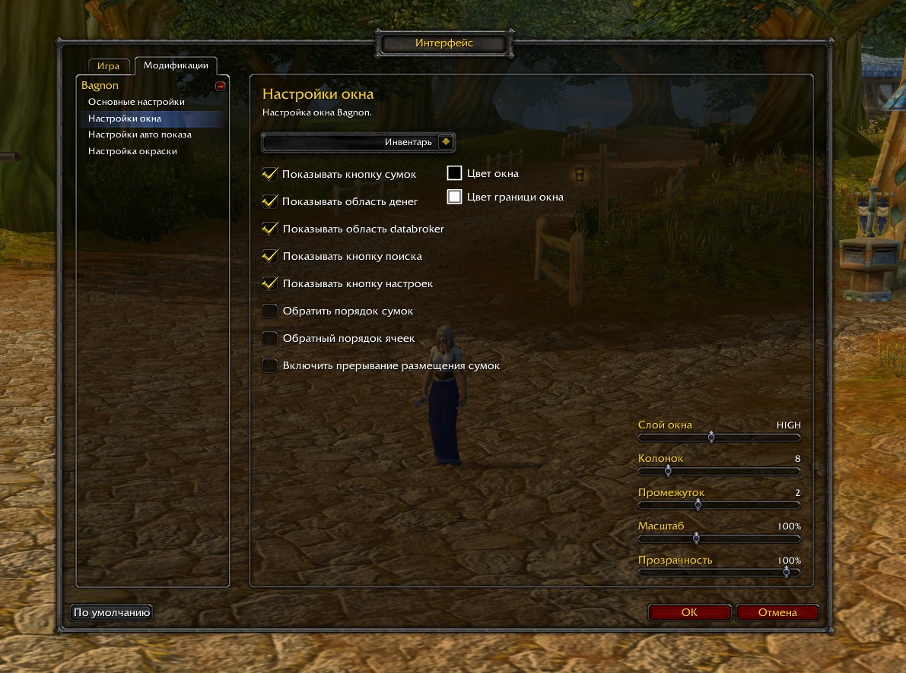
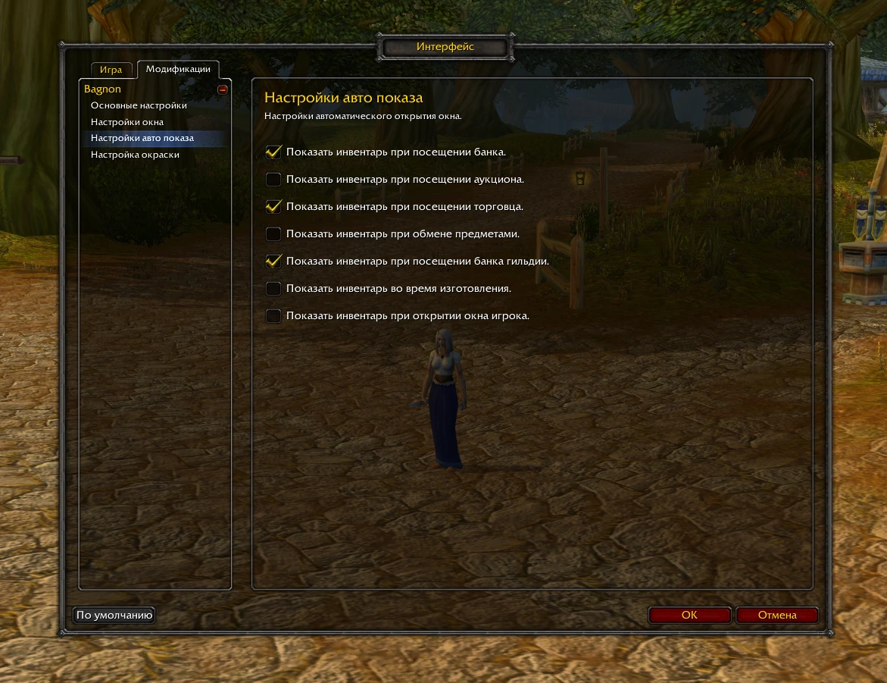
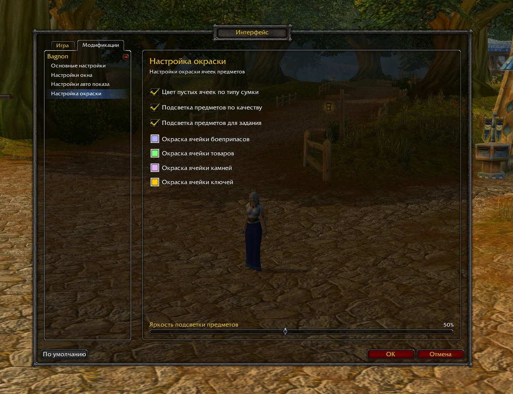

**Bagnon** - модификация для объединения всех сумок в одну. Помимо удобства просмотра инвентаря, имеет еще несколько полезных функций, а также возможность просматривать инвентарь и банк своего и других своих персонажей в любом месте мира.

Особенности:
- Быстрый поиск по названию предмета в инвентаре;
- Есть возможность посмотреть ячейки каждой из сумок в инвентаре;
- Гибкие настройки и наличие дополнительных аддонов, которые добавляют еще больше функционала.

Настройка:\
ESC -> Интерфейс -> Модификации -> Bagnon - окно настройки.

**Скриншоты:**

